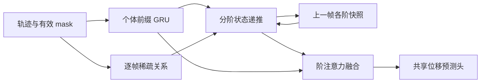

# 方案 A：阶数分离的时间递推社会传播

2026-10-14；设计版本 A0，**未实现、未训练、创新待验证**。简称 TOHI-Net-A，仅用于方案索引。完整公共输入输出、建图、ego 编码、解码及术语见 [共用协议](00_SHARED_CONTRACT.md)。

## 1. 完整网络

历史轨迹与 mask → 个体前缀 GRU → 每帧稀疏有向关系图 → $1\ldots H$ 阶递推状态 → 个体自适应阶融合 → 共享多步预测 head → 未来轨迹。时间从 1 到 $T_o$ 扫描；每帧所有社会阶读取 **上一帧快照**，不得原地修改后供更高阶读取。

## 2. 核心公式与信息传递

令 $s_{i,t}^{0}=h_{i,t}^{0}$。对 $q=1,\ldots,H$，$s_{i,0}^q=0$，第一帧不建社会边，且 $s_{i,1}^q=0$。

$$m_{i,t}^q=\sum_{j\in\mathcal N_i^t}\alpha_{ij,t}W_qs_{j,t-1}^{q-1},$$
$$\gamma_{i,t}^q=\operatorname{sigmoid}(g_q(h_{i,t}^0,f_{i,t}^{agg})),\qquad
s_{i,t}^q=\gamma_{i,t}^q\odot s_{i,t-1}^q+m_{i,t}^q.\tag{A1}$$

$f^{agg}$ 是当前前缀关系特征的平均，空邻居为零；$\gamma\in(0,1)^d$。核心传播先保持线性社会状态，不在不同阶间执行任意残差混合。加入 message gate 的变体必须明确它不改变依赖支持，不能把 ego 自身 bias 写入不存在的高阶通道。

阶融合在时间扫描完成后进行：

$$\beta_i=\operatorname{softmax}_q\big(b_q(h_{i,T_o}^0,s_{i,T_o}^q)\big),\quad
c_i=\operatorname{MLP}_{mix}\left([h_{i,T_o}^0\Vert\sum_{q=1}^H\beta_{i,q}s_{i,T_o}^q]\right).\tag{A2}$$

阶融合的标量权重由个体特征决定，但该表示不宣称解释真实社会因果。decoder 采用共用 head；首版输出确定性轨迹，概率 head 仅作为后续共享扩展。

## 3. 时间顺序与社会阶数定义

取 $\gamma=1,W=I$ 看线性骨架：

$$s_t^1=\sum_{\tau=2}^{t}A_\tau h_{\tau-1}^0,\qquad
s_t^2=\sum_{2\le\tau_1<\tau_2\le t}A_{\tau_2}A_{\tau_1}h_{\tau_1-1}^0.\tag{A3}$$

每次从 $q-1$ 到 $q$ 跨过一条社会边；同阶 carry 只是本人的时间等待。一般 $s_t^q$ 汇总严格递增的 $q$ 条社会边序列。证明依据是 A1 仅访问 $t-1$：不存在一帧内 $q-1$ 刚更新就被 $q$ 使用的通路；支持范围可归纳。学习门控使权重非线性，A3 不再是其精确数值表达，但依赖的时间支持不变。

该状态可以包含回返到同一行人的 walk，并非 simple path；不声称保留每条路径身份。$q>T_o-1$ 的通道没有有效社会链，默认 $H\le T_o-1$。严格跨帧约束会拒绝同帧二跳，可能失去现实中的快速反应，这是需测的归纳偏置，不是普遍物理真理。

## 4. 参数共享、张量和接口

| 模块 | 输入→输出 | 共享 |
|---|---|---|
| ego GRU | `[B,T_o,N,F]`→`[B,T_o,N,d]` | 所有人、所有时间共享；独立 ego 状态 |
| 关系打分 | 有效候选边→`edge_index[2,M]`,`weight[M]` | 时间、人和场景共享 |
| 分阶传播 | 上一帧 `[B,N,H+1,d]`→当前社会 `[B,N,H,d]` | $W_q,g_q$ 跨时间/人共享，阶间默认不共享 |
| 阶融合 | ego 与各阶→`[B,N,d]` | 对所有行人共享 |
| head | `[B,N,d]`→`[B,T_p,N,2]` | 对所有行人共享 |

稀疏 scatter 版本没有 `[N,N]` 状态要求；图不跨 batch。测试时置 eval，随机源固定。无邻居 $m=0$；始终独立的行人 $s^q=0$，输出退回 ego head。失效轨迹关闭消息并清零状态，恢复时重新初始化，避免不同人 ID 或跨 gap 污染。序列之间必须重置状态。

## 5. 时间与空间复杂度

假设每帧 $M_t\le Nk$。先对节点状态做 $W_q$ 变换，再稀疏聚合，传播与门控约：

$$O\left(BT_oH(Nd^2+Nkd)\right).$$

另加 ego $O(BT_oNd^2)$、建图朴素 $O(BT_oN^2)$、关系 MLP 约 $O(BT_oNkd^2)$、融合与 head 约 $O(BN(Hd^2+dT_p))$；完整模型不能只报社会聚合成本。推理滚动状态内存 $O(BNHd+BNk)$，训练保留时间图约 $O(BT_oNHd)$，还有关系和参数梯度。$H=3,d=64,k=8,T_o=8$ 为原型规格，非已验证最优超参。

## 6. 来源与重新设计的部分

- 来源：多跳社会深度问题借鉴 [HighGraph §1/4](https://openaccess.thecvf.com/content/CVPR2024/papers/Kim_Higher-order_Relational_Reasoning_for_Pedestrian_Trajectory_Prediction_CVPR_2024_paper.pdf)；记忆递推与 message passing 借鉴 [TGN §3](https://arxiv.org/pdf/2006.10637)；跨时间建模问题已有 [UniEdge §III](https://www.hubertshum.com/publications/tcsvt2025trajectory/files/tcsvt2025trajectory.pdf)。GRU/MLP/softmax/多步预测头是成熟组件。
- 本项目重新组合的结构：把 ego、等待记忆与精确社会边次数分离；跨帧阶增量读取上一帧快照；共享同一稀疏图但按阶投影，最后才融合。属于设计提案，不声称原创数学定理或首次实现。
- 不沿用 HighGraph 的同帧 $\widehat A_t^m$、全阶拼接层；不沿用 UniEdge 的 patch 时空双图、Hodge 过滤和未来占位 Transformer。仅把其预测器换成 GRU 并不算本方案，核心应是 A1。

## 7. 实现难度、风险与验证

难度低至中：共享编码、稀疏 scatter 和状态缓存；关键错误是读写顺序、阶混合以及 mask。创新风险较高：审稿人可能认为是一般动态 GNN 加 hop 标签，须与无阶 GNN+GRU、共享/非共享 $W_q$、普通时间层堆叠、等参数容量扩展比较。

验证：正序两事件链能影响终点，逆序不能；梯度前缀不依赖未来观察；没有第二社会边时二阶必须为零；加入等待帧不增加社会阶数；变人数/单人/空边正常；$H=1,2,3$、冻结/打乱图顺序、随机等预算稀疏图、gate on/off 消融。先用人工图确认依赖，再用合成运动，再用 ETH/UCY；自然轨迹顺序打乱会改变运动信息，不能单独当机制证据。完整协议见 [实验设计](04_EXPERIMENT_PLAN.md)。

初步审稿判断：更适合第四章第一版和可控的增量创新，是否够独立小论文取决于公平对照结果；不能预判其一定优于 HighGraph/UniEdge。
