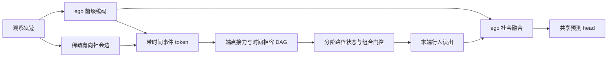

# 方案 B：时间相容交互事件 DAG 与阶路径状态

2026-10-14；版本 B0，**未实现、未训练、创新待验证**。简称 TOHI-Net-B。共用输入输出、ego 前缀编码和 decoder 见 [共用协议](00_SHARED_CONTRACT.md)。

## 1. 完整网络

轨迹 → ego 特征和稀疏候选关系 → 每个有效有向社会关系建立事件 token → 根据端点接力与时间约束建 DAG → 按阶传播事件路径状态 → 聚合至末端行人 → 与 ego 融合 → 共享多步预测 head。不同于 A 的节点历史缓存，B 保留“哪个交互事件接哪一个后续交互事件”的局部身份。

## 2. 事件定义与传播条件

定义 $e=(j\to i,t)$，$t\ge2$；$\operatorname{src}(e)=j$、$\operatorname{dst}(e)=i$、$\operatorname{time}(e)=t$，不建自身社会事件。对前事件 $e'=(k\to j,s)$，仅当：

$$e'\prec e\iff\operatorname{dst}(e')=\operatorname{src}(e),\quad 1\le t-s\le\Delta,\quad\text{同场景且中介在间隔内有效}.\tag{B1}$$

事件节点严格升时，图无环；没有同帧事件间连接。即使同时存在 $j\to i$ 与 $i\to j$ 也不会形成同帧循环。默认允许跨帧返向；禁止立即回返作为可选消融，不称现实中一定不回返。$\Delta$ 按真实时间设置，帧间隔仅是等采样率特例。

## 3. 数学公式与阶数有效性

$$z_e^1=\phi_{event}([h_{j,t-1}^0,h_{i,t}^0,f_{ji,t},\operatorname{PE}(t)]).\tag{B2}$$

$z_e^1$ 含一个交互事件。对 $q\ge2$，定义有效前驱集合 $\mathcal P_q(e)=\{e':e'\prec e,\ z_{e'}^{q-1}\text{有效}\}$：

$$\ell_{e'e}^q=a_q^\top\tanh(W_Qz_e^1+W_Kz_{e'}^{q-1}+W_\tau\operatorname{PE}(t-s)),$$
$$\omega_{e'e}^q=\operatorname{softmax}_{e'\in\mathcal P_q(e)}(\ell_{e'e}^q),$$
$$g_{e'e}^q=\operatorname{sigmoid}\left(G_q[z_{e'}^{q-1}\Vert z_e^1\Vert\operatorname{PE}(t-s)]\right),$$
$$z_e^q=\sum_{e'\in\mathcal P_q(e)}\omega_{e'e}^q\left(g_{e'e}^q\odot\phi_q([z_{e'}^{q-1}\Vert z_e^1])\right).\tag{B3}$$

前驱集合为空时 $z_e^q=0$ 且 `order_valid[e,q]=False`，绝不能只靠 MLP bias 产生“虚构高阶”；masked softmax 不可对全 $-\infty$ 行直接运算。所有 $q$ 从上一阶张量取值，事件 timestamp 索引另独立约束。B3 的表示含恰好 $q$ 个相容交互事件，但聚合多条前驱链，**不会保留每条完整路径的独立身份**。

行人读出对终点为 $i$ 的有效事件按结束时间和阶数注意力池化：

$$c_i^q=\sum_{e:\operatorname{dst}(e)=i,\ valid(e,q)}\eta_{i,e,q}z_e^q,\quad
\eta_{i,\cdot,q}=\operatorname{softmax}_e r_q(h_{i,T_o}^0,z_e^q,\operatorname{PE}(T_o-t_e)),$$
$$c_i=\operatorname{MLP}_{mix}([h_{i,T_o}^0\Vert c_i^1\Vert\cdots\Vert c_i^H]).\tag{B4}$$

读出没有有效事件的通道返回零。未来预测用共用 head，不能用未来真实接触事件来建观察 DAG。

## 4. 张量、参数共享与构图实现

| 数据 | 形状 | 备注 |
|---|---|---|
| ego | `[B,T_o,N,d]` | 公共 encoder |
| 事件索引 | `event[M,4]` | 场景、source、destination、time |
| 事件关系与状态 | `[M,F_e]`, `[M,H,d]` | $M\le BT_oNk$ |
| DAG 连接 | `[2,E_D]` | 不构造 `[M,M]` 密集矩阵 |
| 阶有效 mask | `[M,H]` | 路径阶数存在性 |
| 终点读出 | `[B,N,H,d]` | 分场景 scatter 池化 |
| 融合/输出 | `[B,N,d]`→`[B,T_p,N,2]` | 与 A 相同 head |

$\phi_{event}$、时间编码和 $W_Q,W_K,W_\tau$ 默认跨人、时间、阶共享；$a_q,G_q,\phi_q,r_q$ 按阶单独参数。另做完全跨阶共享，以排除 B 的容量收益。按 `(场景,目标人,时间)` 建前事件索引表，后事件只查询其 source 的前 $\Delta$ 时段，避免检查所有事件对。minibatch 切断不同场景，缺失中介或跳帧必须尊重 validity。

## 5. 复杂度与计算预算

每人每时刻最多 $k$ 个入事件；每个后事件可查至多 $\Delta k$ 个前驱，因此 $E_D\le M\Delta k$，即 $O(BT_oN\Delta k^2)$。不需要限制出度来获得这一上界，前提是按后事件源查询其入事件。

关系建图朴素 $O(BT_oN^2)$。事件嵌入 $O(Md^2)$；B3 的联合两事件 MLP 默认每 DAG 连接计算，成本 $O(HE_Dd^2)$，而非只写 $O(HE_Dd)$。若把联合函数改成分离投影/低秩门控，可降为 $O(HMd^2+HE_Dd)$，但这是不同计算变体，必须单独验证。训练状态及连接内存约 $O(HMd+E_D)$，外加联合 MLP 中间激活 $O(HE_Dd)$ 与 encoder。

举例 $N=32,T_o=8,k=8,\Delta=2,H=3,d=64,B=1$：粗上界 $M\le2048$、$E_D\le32768$，不作为实际边数或 FLOPs 测量。密集全部行人连接可能让 $k\sim N$，成本明显上升，需控制邻居预算。B 通常比 A 状态和连接多，是否可接受需实测 CPU 建图+GPU 推理端到端延迟。

## 6. 已有思想与本项目设计边界

已有思想：UniEdge 的边间关系、TGN 的时间事件、[DBGNN](https://proceedings.mlr.press/v198/qarkaxhija22a.html) 的时间相容 walk 与路径 lifting、attention 和门控。**时间事件图/时间有序路径不是首次提出。**

本项目设计：以观察窗内逐帧的有向人际事件实例为 token，显式满足 B1，分离路径阶数并维持有效 mask，以当前交互和前链的几何相容性进行组合，再回到行人预测。它不是把 UniEdge 的无向共享端点边图改名，也不是实现了新的 DBGNN 理论；与更近似动态边 GNN 的同构风险仍待全面检索。

与 HighGraph：不用同帧图幂/不同幂融合，改为事件实例和前后接力。与 UniEdge：不是任意共享端点即可相连，必须前目标=后源、严格升时；不用 Hodge 谱过滤；不以 patch 时间平均和未来 placeholder 作为核心。与 A：没有固定节点 carry 状态，保留事件级历史和组合代价，注意力可分辨不同中介事件但仍压缩完整路径。

## 7. 实现、验证与审稿风险

难度中至高：索引、DAG 稀疏批处理、阶有效 mask、边预算和 pooling；稀疏 scatter 的效率/确定性可能成为难点。必须比较 B1 与“仅共享端点”“仅时间 mask”“方向+时间 mask”“完整相容门控”，以及普通 line graph attention 和 TGN。若只靠删边/加 attention 得到结果，独立论文创新不足。

人工正逆序图、无相容前驱、断轨中介、长等待 $>\Delta$、同帧循环、跨 scene 分离、permutation equivariance 和梯度依赖均需验证。自然数据按接近/避让强度分层，路径可视化只说明模型权重，不能证明真实因果。与 A 共用解码器，实验协议见 [04_EXPERIMENT_PLAN.md](04_EXPERIMENT_PLAN.md)。

初步审稿判断：B 更适合独立小论文的探索方向，但须补齐 HoGAT 与近期时间图文献，再证明超出简单有向 line graph 的收益；不建议当前直接开发完整 B 或先投入大规模训练。
