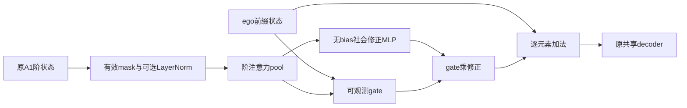

# Stage 2.5 融合设计与冻结边界

日期：2026-10-14。本轮只修改社会特征进入共享decoder的方式。原 `tohi_a.py/order_state.py/order_fusion.py/temporal_graph.py/social_baselines.py` 和 Stage2 权重、结果由 SHA256 保护；不覆盖A0、不开发B。

## 保持的传播核心

$$s_{i,t}^q=\gamma_{i,t}^q\odot s_{i,t-1}^q+\sum_j\alpha_{ij,t}W_qs_{j,t-1}^{q-1}.$$

仍为上一帧快照、相同历史图、半径4m/k=8、H=3、同一contiguous mask和严格升时。归一化只应用于最后时刻的融合输入，不反馈到carry或跨阶传播。正常训练的图候选规则不变，负对照只作为明确的推理干预。

## 四版本与公式

令 $M_i^q$ 是截止时有效阶，$h_i$ 是ego，$z_i^q$ 是交互读出：

$$z_i^q=\begin{cases}M_i^q\operatorname{LN}_q(s_i^q),&N\text{版本},\\M_i^qs_i^q,&\text{其它版本}.\end{cases}$$

LN 是每阶独立、可学习 affine 的LayerNorm，使用PyTorch默认epsilon；**affine后再mask**，所以无效阶不会由bias生成特征。有效阶的零数值与不存在路径不是同一概念。

$$\beta_{i,q}=\operatorname{softmax}_{q:M_i^q=1} b_q([h_i,z_i^q]),\quad p_i=\sum_q\beta_{i,q}z_i^q.$$

全无有效阶时beta与pool为零。A0/N使用原来的 $\operatorname{MLP}_{mix}([h_i,p_i])$，有交互时没有ego恒等路径。R/RN使用：

$$\delta_i=W_2\tanh(W_1p_i),\quad g_i=\sigma(w_g^\top[h_i,p_i]+b_g),\quad h_i^{final}=h_i+g_i\delta_i.$$

两层delta投影无bias，输入仅为实际社会pool；gate仅使用可观测编码，初始 $w_g=0,b_g=\operatorname{logit}(0.05)$。delta投影采用普通非零初始化，使初始社会路径已有梯度，而不是先把整个分支置死。无有效阶时gate=0且精确回ego；关闭residual是推理干预，不是碰撞后处理。

| 版本 | 原始传播 | 融合前LN | ego主路径 |
|---|---|---|---|
| TOHI-A0 | 原A1 | 无 | 原MLP重映射 |
| TOHI-A-R | 原A1 | 无 | ego+gate×delta |
| TOHI-A-N | 原A1 | 有 | 原MLP重映射 |
| TOHI-A-RN | 原A1 | 有 | ego+gate×delta |

这些是成熟的残差、门控、归一化思想的诊断应用，不能把它们本身宣称新的高阶传播理论。A0别名包装数值与原实现逐位相同；变体初始ego/decoder/图/A1参数相同，新增融合参数导致总容量不同。

## 普通社会对照与容量

FirstOrder-GNN-RN 使用同一改进融合、一个社会阶，只收邻居ego。Dynamic-GNN-RN使用原动态社会GRU的混合状态作为一个读出channel，**它不是一阶社会状态**，不能从通道数推断它没有多跳影响。其hidden包含自己的运动编码，因此收益也可能涉及额外容量，不能都归因于邻居信息。

PedBase-Wide 的宽度120、参数120024，接近A0的120092（差约0.057%），但encoder/decoder宽度不同；RN参数116381，不是严格等容量比较。所有图模型hidden64、原decoder规格不变。全部模型记录实际参数，禁止把总数不同称严格容量对照。

## 预先固定的验证协议

`configs/stage2p5/protocol.json` 在训练前提交。第一轮10模型同一256/96窗口、seed17、30epoch、batch8、Adam0.001、原L2和grad clip1。每轮记录训练loss、验证ADE/FDE、状态/权重/gate、梯度和耗时。最小验证ADE选择best，精确相等取最早；同时报告last30及best所对应FDE，不单独挑FDE最优点。

第二轮预先生成包含原256窗口的固定1024训练子集，验证96窗口完全不变；seed17/42/2026不因成绩丢弃。若全部社会模型best ADE比PedBase差超5%且FDE无改善，按预定规则暂停；否则选最多两个社会模型+PedBase。这是开发验证筛选，不是独立测试，更不能对ETH测试调参。

分组由历史候选图确定：截止可见行人，平均有效连续时刻入度0、(0,1]、(1,3]、>3；二/三阶支持在截止时是否存在。未来GT只决定指标可评价mask，不决定分组。图负对照在同半径、连续有效、自环排除、同场景候选中保持每个target的入度，随机选边后重算几何和alpha。候选集不足时无法改变关系，将记录实际改变比例。

## 新增测试

验证A0数值一致、原传播/图不变、invalid LN bias屏蔽、0.05初始gate、社会修正改变预测且梯度非零、无邻居精确回ego、置换/padding/前缀/GT隔离、同度合法随机图、固定分组与筛选规则及旧结果不变。最终结果另见总报告与JUnit。
