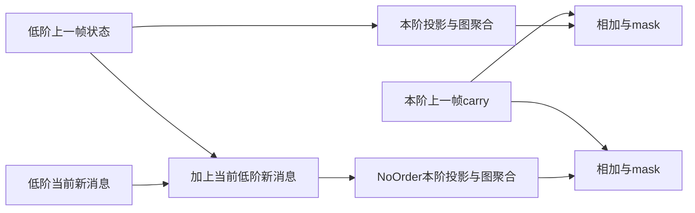

# 时间约束的独立计算规则对照

日期：2026-10-14。训练源commit为ec8f665c1faab7ee6cd64172c8852c904c8f012b；严格H3与NoOrder参数均115997，同d64、编码/残差/decoder/图候选、优化与数据。两个模型所有种子分别从头训练，不复用旧A-R权重。

## 只放宽高阶边时间

严格版保持原A1：每阶读上一帧低阶状态，路径边时间严格递增。NoOrder是**非严格升时**对照，允许同帧的已收到低阶消息再传一跳，仍不使用后续帧。名字不意味着无因果前缀或乱序原轨迹。

$$m_t^1=E_tW_1h_{t-1},\quad m_t^q=E_tW_qs_{t-1}^{q-1},\quad s_t^q=\gamma_t^q\odot s_{t-1}^q+m_t^q.$$

$$\widetilde m_t^1=E_tW_1h_{t-1},\quad\widetilde m_t^q=E_tW_q(s_{t-1}^{q-1}+\widetilde m_t^{q-1}),\quad\widetilde s_t^q=\gamma_t^q\odot s_{t-1}^q+\widetilde m_t^q.$$

continuity/有效阶mask、每阶carry、E_t的候选与alpha计算、q1的ego输入完全保留。两版每帧每阶均一次线性投影+聚合，NoOrder额外张量加法O(BNd)。没有用新low-order STATE作为源，因此不把已有路径额外乘低阶carry gate；只加入当前新message。实际输入[B,8,N,2]，hidden[B,8,N,64]，状态[B,8,N,3,64]，最终同一残差读出和12步head。

该控制隔离一个源消息可用时间的计算规则，不能说有效walk总数也相同。新增同帧路径改变了信息年龄、路径数和数值尺度；这些是约束放宽的相关后果。如果要把精度差进一步归因于单纯顺序而排除路径质量/数量/尺度，还需独立预算/尺度控制，本阶段不混入归一化。

## 依赖结构测试

| 人工情况 | 严格版 | NoOrder | 实测状态/梯度 |
|---|---|---|---|
| 0→1在t1、1→2在t3 | 二阶可达 | 二阶可达 | gamma0.5的一帧等待后状态0.5；源h0梯度0.5 |
| 1→2先、0→1后 | 该二阶不可达 | 不可逆时间补链 | 对应支持/数值为零 |
| 同帧0→1→2→3 | 只一阶 | 二/三阶可达 | 三阶状态1且只依赖此前h0，不读未来h |
| 单边与等待 | 不增长阶数 | 不增长阶数 | 无二/三阶，carry按0.5衰减 |
| 两条相容路径 | 两路径求和 | 同样保留 | 0→1/2后到3，两份0.5相加为1 |

前缀、场景隔离、padding、置换、无邻居回ego、有限梯度、同参数初值及相同15次projection/aggregate人工预算均通过。严格H3与原A-R同权重的CPU前向/反向逐位相同。测试通过后才训练，原始轨迹帧从未打乱。

## 路径预算与解读

验证集拓扑严格三阶timed-walk为8806775，NoOrder为21413010，约2.43倍；四名不同身份占比70.60%与69.97%。截止可见目标三阶任意walk覆盖95.35%/96.57%，四名不同身份链覆盖88.66%/90.38%。更多时间实例不等于同比增加独立信息。计数不使用未来GT、alpha或gamma，属于历史图规则统计，非社会因果事件。

实际三种子训练结果如下。指标为固定96开发验证、每个模型相同30epoch最佳ADE与配对FDE，不能视为ETH或五场景正式测试。

## 真实独立训练结果

| seed | H3 best epoch | H3 ADE/FDE | NoOrder best epoch | NoOrder ADE/FDE | ΔADE H3-NoOrder | ΔFDE |
|---:|---:|---|---:|---|---:|---:|
| 17 | 21 | 0.444021/1.077690 | 20 | 0.440281/1.066659 | +0.003740 | +0.011031 |
| 42 | 29 | 0.441430/1.066659 | 13 | 0.448335/1.087369 | -0.006905 | -0.020710 |
| 2026 | 20 | 0.447209/1.085131 | 10 | 0.448684/1.095402 | -0.001475 | -0.010271 |

严格H3均值ADE/FDE=0.444220/1.076493m，NoOrder=0.445767/1.083143m。严格版平均较好，但seed17两指标都更差、另外两个更好；ΔADE均值-0.001547m、sample std0.005323m。主效应小于配对波动，没有跨seed稳定顺序收益。last时严格FDE均值反而高0.002666m，进一步限制结论。

这是一个参数/候选图/每阶投影聚合预算相同的规则对照，结论是该规则没有被当前证据稳定支持；不能泛化为时间因果性无用。NoOrder仍有因果前缀，路径数/年龄/尺度不同，未执行匹配有效walk总量或独立尺度归一化控制。未来如主张纯顺序机制，需要在可比事件/路径预算下补齐这些控制。
