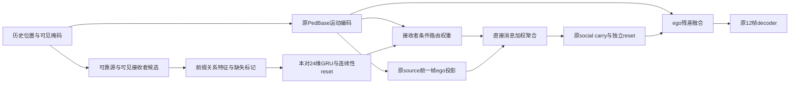

# Relation-Routing：直接消息的历史关系选择原型

冻结结构c8d151c8c53367ef361d23d30569c9ea5ff8cf52；代码[src/models/relation_routing.py](../../src/models/relation_routing.py)。动机是验证历史关系是否提供独立于当前运动编码/额外容量的收益，不增加阶数。不因GRU或attention命名而宣称创新。

## 输入、关系连续性与信息路径

候选资格、sender可靠性、Receiver-Fix缺失策略、H1投影payload、carry与ego残差完全复用。仅替换alpha打分模块。每对有向关系j→i计算12维可观察特征：

$$q_{ij,t}=[r_{ij,t}(2);v_{j,t}(2);\widetilde{v_i-v_j}(2);\widetilde\tau(1);d^{safe}(1);k_i(1);k_j(1);\rho_i(1);\rho_j(1)],$$
$$\rho_{i,t}=\frac{\sum_{s=0}^{t}m_{i,s}}{t+1}.$$

未知target速度用k_i=0显式标记，相对速度/CPA是缺失槽位；source必须k_j=1，源速度是真实两点差分。可见比例只计算前缀，不偷看该目标随后会观察几帧。

$$\ell_{ij,t}=\mathbf1(C_{ij,t-1})c_{i,t}c_{j,t},\quad
e^-_{ij,t}=\ell_{ij,t}e_{ij,t-1},$$
$$e_{ij,t}=\operatorname{GRU}_{24}(q_{ij,t},e^-_{ij,t}),\quad
s_{ij,t}=\operatorname{MLP}_{88\to64\to1}([h_{i,t};e_{ij,t}]),$$
$$\alpha_{ij,t}=\frac{\exp s_{ij,t}}{\sum_{k\in\mathcal N_{i,t}}\exp s_{ik,t}},\quad
M_{i,t}=\sum_j\alpha_{ij,t}W h_{j,t-1}.$$

关系从候选集合消失立即清零；一端消失、重新进入或时间gap也清零。无跨窗口缓存，不凭空把一次断开的关系延续。新receiver第一次关系状态从零更新，但可收到消息。每对记忆仅依赖该对历史特征和当前接收者ego；不交换相邻边状态，不进行关系图卷积。

信息路径为历史两人的几何/运动→本对GRU→receiver条件打分→直接邻居ego投影的加权和→独立reset的social carry→原ego残差→原decoder。pair-state只影响alpha，不作为直接运动修正输入；它仍可能学习通用权重，需实验归因。

## 形状、参数共享和实际实现成本

历史位置[B,8,N,2]，ego[B,8,N,64]，每帧边输入[E_t,12]、边状态[E_t,24]、权重[E_t]，节点social[B,8,N,1,64]，输出[B,12,N,2]。GRU、打分、projection/carry/fusion/decoder在所有pair/时间/场景共享，pair索引仅用于缓存，不是身份embedding。

History名义73355参数、8321个单阶融合死参数，有效65034；NoUpdate与Random也完全73355。相对Receiver-Fix少272个名义参数，不是简单增加总容量。Current70931，Uniform73627但含17090死参数（单阶scorer+被均匀权重绕过的关系scorer），比较同时给名义和有效容量。

进一步容量审计：NoUpdate先前隐状态恒0，使edge_gru.weight_hh的3×24×24=1728参数也不影响输出、梯度恒0；其已知活跃参数应为63306，而History/Random为65034。训练时config/summary的structurally_dead_parameters原始计数只统计scorer，不包含这一循环权重；保留原记录，并以parameter_capacity_audit.csv列全已核实死参数。不能称History/NoUpdate严格相同有效容量；总参数匹配以及循环权重失效都是删除记忆机制的结构后果。

边GRU算量O(ΣE_t d_e(12+d_e))；alpha O(ΣE_t d( d+d_e))；继承Receiver-Fix节点计算和稠密几何排序。虽然仅更新实际稀疏边，当前缓存实现[B,N,N,24]，内存O(BN²d_e)、每帧清零写入O(BN²d_e)，训练需保留时间反传；不能声称全实现严格O(E)内存。T=8、d_e=24、d=64、k≤8。本原型没有边图M×M谱传播成本。

## 必需机制对照

| 对照 | alpha机制 | 独立训练 | 单因素解释 |
|---|---|---|---|
| PedBase | 无社会分支 | 完全兼容冻结旧结果 | 基础能力；较少参数 |
| Receiver-Fix | 原当前frame关系MLP | 是 | 接收政策修复 |
| Routing-Current | q经12→24 Tanh MLP、receiver条件打分 | 是 | 普通当前帧关系权重；编码结构/容量不同 |
| Routing-NoUpdate | 同GRU每帧先前state=0 | 是 | 与History同参数同初值，仅删除时间记忆 |
| Relation-Routing | GRU继承相容pair历史 | 是 | 主记忆变体 |
| Routing-Uniform | 相同候选uniform alpha | 是 | 无选择权重；名义死参数单列 |
| Routing-Random | 同GRU、同receiver边数、同场景可靠随机源 | 是 | 放宽4m的非局部训练负对照；不是纯同分布关系置换 |

Random用仅当前历史位置+时间的无身份索引hash排名，无未来、无自环/跨场景/重复；按真实图每receiver入度匹配，几何hash极少同分时整组规则可少边，实际差异必须核查。它改变距离分布/关系连续性，因此只能支持或否定特定关系依赖，不能排除所有社会信息作用。固定checkpoint删除消息/重置记忆/均匀权重/随机图仅为辅助计算敏感性，另列。

实际历史合法性审计：CUDA真实边43708、随机边43529，少179条（0.410%），175个receiver×时刻入度变化。float32 hash同分并非严格零概率，不能写成完全同边数；替换28546条（65.579%）、超4m26074条（59.900%）。CPU随机边43542，跨设备hash候选也有差别（relation_legality.json记录），训练和主模型评价均固定CUDA；辅助CPU干预各自使用CPU原图作参考。这个控制不能声称严格单因素/同分布。以上计算/协议不因结果变化而重设计，保留已冻结首轮。

## 文献核查与创新边界

核查2026-10-15：多源检索MCP未挂载；OpenAlex备用脚本在兼容Python下返回429；改用官方作者稿/arXiv/CVF。记录包含失败来源，不虚称全面检索。

- **UniEdge** (Li等，2025，[作者稿](https://arxiv.org/html/2502.02504v1)，§III-B–D)：patch内统一行人时间图、共享端点边图的Hodge-Laguerre传播、边增强节点以及Transformer未来占位预测器。此处只用逐帧直接候选和本对GRU选择，没有patch、E2E传播或Transformer。计算结构不同，但“边信息影响节点”已经是已有思想。
- **Structural-RNN** (Jain等，CVPR2016，[正式论文](https://www.cv-foundation.org/openaccess/content_cvpr_2016/papers/Jain_Structural-RNN_Deep_Learning_CVPR_2016_paper.pdf)，§3)：节点与边因素RNN及因子共享。边递归记忆/共享本身不能作为新贡献。
- **Social Attention** (Vemula、Muelling、Oh，ICRA2018，[作者正式稿](https://publications.ri.cmu.edu/storage/publications/2018/08/main.pdf)，§IV)：尤其接近，沿用S-RNN的空间/时间边RNN，并学习社会注意力。历史关系RNN加receiver选择在行人预测中已有先例，不能把换成GRU当创新。
- **Temporal Graph Networks** (Rossi等，2020，[arXiv](https://arxiv.org/abs/2006.10637))：通用事件图的记忆与图操作框架，其主要记忆对象与任务和本对窗口记忆不同；因果时序记忆也不是新概念。本次只核查摘要范围，不伪称完整复现。

来自已有：GRU/attention、关系运动特征、残差、自身运动编码、按场景共享。HTraj此次重新设计并测试：可见接收者与carry连续性分离、显式未知速度安全候选、同候选预算下等参数零记忆对照、原直接延迟payload保持不变的关系选择模块、部分历史分组与停止规则。它们是可审计的工程结构与假设；是否具有论文方法贡献仍待稳定收益和与最近边记忆方法更全面比较，当前原型不能自动升级为第四章正式网络。

与更近的Social Attention计算差异：它以注意力汇聚空间edgeRNN hidden作为nodeRNN输入并递归预测；本原型pair记忆只产生标量alpha，真正传递的是独立运动encoder的source h_t-1，通过保留ego的无偏置残差交给既有确定性12步head。输入可见性/速度缺失契约也被显式控制。该结构差异可核验，但不足以单独保证方法创新性或精度优势。

训练判断见[实验结果](04_EXPERIMENT_RESULTS.md)、[消融](05_ABLATION_ANALYSIS.md)、[研究决定](06_RESEARCH_DECISION.md)。
