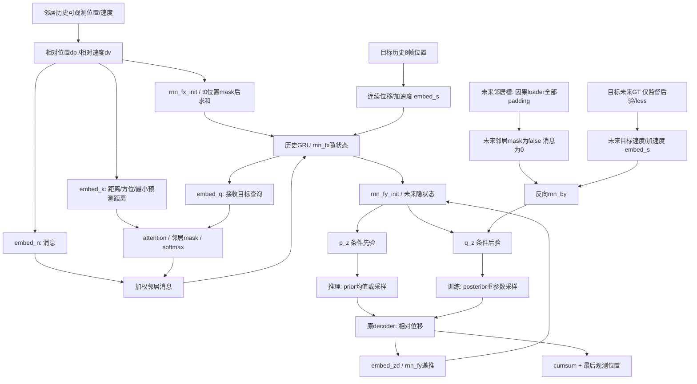

# SocialVAE社会信息路径审计

冻结作者源码 `eb23cbae562bac2c2dcf0d81529e6ab2ac280962`，文件位于 `experiments/stage5/cache/socialvae/eb23cbae562bac2c2dcf0d81529e6ab2ac280962/social_vae.py`。本阶段不修改源码。来源定位：`__init__`约103–153行，`attention`约155行，`enc`约166–230行，`forward`约233行，`learn`约307行，`loss`约348行；准确位置以冻结文件为准。

## 分层信息流

历史社会初始化：`h0 = sum_j mask_0ij * rnn_fx_init(dp_0ij)`。它不经过attention，单关attention不够。历史逐帧消息：`m_t = sum_j alpha_tij * embed_n(dp_tij,dv_tij)`，其中 `alpha = softmax(leakyReLU(embed_k(features) · embed_q(h_prev)))`；GRU输入顺序为 `[m_t,embed_s(v_t,a_t)]`。这里速度是米/采样步的位移量，采样固定0.4s；分组统计另转换m/s，未修改模型单位。

训练时`enc(x,neighbor,y=y)`还会将未来时刻邻居消息与目标未来运动特征送入`rnn_by`。**原架构具备此路径，但本任务的因果loader将12帧未来邻居槽全部设为padding，该路径实际为零**。后验仍通过历史隐状态接收历史社会信息：`q(z_t | h_y,t,b_t)`；预测prior和decoder也经`h_x -> h_y`间接依赖历史邻居。只有后验可读取目标未来标签，推理prior不读取GT。

## 其他路径及Jacobian限制

`learn`、`forward`、`rnn_fy`、`embed_zd`和decoder没有单独的邻居入口，依赖来自编码状态。模型没有跨batch BN或跨目标batch混合；每条目标样本在GRU batch轴独立，邻居只通过上述目标中心的历史上下文进入。不存在持久跨窗口隐状态。

官方在`enc`开头使用`torch.no_grad()`构造相对特征，导致Full对原始邻居张量的autograd Jacobian也可以为None。这不代表Full没有功能依赖。必须同时检查固定权重/固定潜变量噪声下的邻居干预；Full的合法位置、速度、数量和进入时间干预会改变预测，NoSocial必须不变。源码不因本审计而修复detachment，避免改变冻结对照。

人工测试与真实参数探针分别见 `tests/test_socialvae_attribution.py`、`results/tables/stage5p3/isolation_tests.*` 和 `capacity_audit.json`。这些属于结构/梯度验证，不是性能训练结果。
