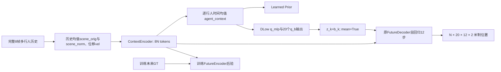

# AgentFormer实际信息路径审计

本报告仅分析Stage7.4保存的官方validation预测，不重新评价test。官方源码e4fe8dd6df3b3d2033665c5f8ac3544e81c44db5，作者CVAE+DLow、mean=True、K20、8/12帧、0.4s、米制、完整20帧离线上下文资格均保持不变。协议在034727969d0892632889bf5e038c0fac5f892d53提交；原始文件数值列修复在350aceb提交后执行。未训练、未更新模型参数、未增加模块。

HOTEL/ZARA2是权重fold名称；validation分别来自其余7个来源录像的_val区域，并非对应held-out录像的test。两折共享3944个目标窗口，history/GT SHA完全相同，不能作为两个独立确认集。窗口加权、来源录像内行人ID等权和逐来源结果分别保存。相同行人可跨历史运动组出现，组内人数不可相加。旧test已经被观察过，未来不能称为完全未接触的独立确认集。

完整数值及有效方向样本数见[complete_group_statistics.json](../../results/tables/stage7p5/complete_group_statistics.json)，原始逐目标/逐head表见同目录。早期group_statistics.json可能漏掉首行未定义的方向列，已明确由complete版本替代；旧文件和失败记录保留。空值代表方向不可靠或无适用样本，不填0。

## 冻结实现，而非新模型

以[官方固定版本](https://github.com/Khrylx/AgentFormer/tree/e4fe8dd6df3b3d2033665c5f8ac3544e81c44db5)为准。论文方法见[AgentFormer，§3及§4](https://arxiv.org/html/2103.14023v3)。论文与维护配置的具体差异以源码记录，不把2021文章描述等同所有后续默认值。

源码定位均相对上述commit：`model/agentformer.py:103–168`、`171–256`、`259–427`、`515–583`；`model/agentformer_lib.py:278–330,377–378`；`model/dlow.py:92–137`；两折`cfg/eth_ucy/*/*_agentformer_pre.yml`。

1. 当前ContextEncoder输入是scene_norm和vel，线性映射4→256，8N个token进入2层、8头Transformer，FF维512；输出按每个行人跨8帧平均得到N×256。位置减去全部历史观测的场景均值；vel是每帧位移，诊断时除0.4才得到m/s。没有把未知速度伪造成新模块输入。
2. Agent-Aware Attention对同一行人token和其他行人token分别计算Q/K得分，再使用mask和softmax。当前默认`gaussian_kernel=False, sep_attn=True`。它并非未建模交互；可以通过学到的token表征隐式表达相对关系。
3. 两折配置未设置有限conn_dist，默认100000触发全连接mask。2m邻居只是本阶段的历史分组半径，绝不是模型原始attention半径。
4. 当前输入没有显式边特征`(x_j-x_i,v_j-v_i,closing)`。但“没有手工边特征”不等于“无法表达相对运动”，也不证明增加边模块有益。scene_orig本身依赖上下文成员，邻居删除同时改变坐标原点，干预会有混杂。
5. Learned Prior从历史agent_context生成潜变量分布；训练FutureEncoder使用有标签未来。DLow正式推理显式传入z=b，因而不是从该prior独立抽20次；q_A仍影响DLow训练KL，但mean=True前向的z不包含A乘噪声项。head0不是数学期望或最高概率候选。
6. FutureDecoder通过原跨agent attention使用历史与已预测未来token，自回归12步，不把未来GT作为推理输入。官方loader的完整20帧资格会利用未来存在性筛选上下文，本阶段接受并声明这一离线benchmark语义。

若N为行人数，历史attention约O((8N)²d)；K20解码包含12次增长的时空token attention及历史交叉attention。未新增参数或推理成本。本阶段不重新加载/推理作者模型，沿用已核验输出，来源字节SHA再核对。
